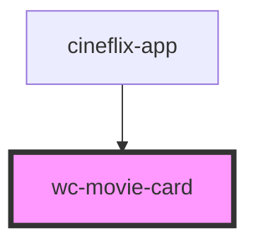

# wc-movie-card

<!-- Auto Generated Below -->

## Properties

| Property | Attribute | Description | Type      | Default     |
| -------- | --------- | ----------- | --------- | ----------- |
| `movie`  | --        |             | `Movie`   | `undefined` |
| `saved`  | `saved`   |             | `boolean` | `false`     |

## Events

| Event             | Description | Type                  |
| ----------------- | ----------- | --------------------- |
| `movieSelected`   |             | `CustomEvent<number>` |
| `watchlistToggle` |             | `CustomEvent<number>` |

## Dependencies

### Used by

 - [cineflix-app](../cineflix-app)

### Graph

----------------------------------------------

*Built with [StencilJS](https://stenciljs.com/)*
